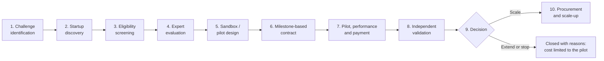

# InnovProcure

**A startup-friendly public procurement pathway: from a department's problem to a tested, paid and scaled startup solution.**

Smart India Hackathon 2026 · Problem statement **SIH26136** · Government of Maharashtra (Maharashtra State Innovation Society)

> Live demo: **https://innovprocure.vercel.app**
>
> This is a prototype. Every department, startup, person, amount and result in it is made-up demo data. Nothing here is a real tender, a real payment or an official statistic.

## The problem

> "Startup friendly public procurement mechanism that enables government departments to identify, pilot, procure, and scale innovative solutions from eligible startups."

Departments have problems that startups can solve, but the usual tender route asks for prior turnover and past government work, takes months, pays late, and gives the department no safe way to try a new solution before buying it. InnovProcure is one structured pathway that both sides can follow.

## The pathway

Every challenge moves through the same ten stages. Each stage has an owner, a clear output and an entry in the audit trail.



| #   | Stage                       | Who acts                     | What the app does                                                                                                                                                   |
| --- | --------------------------- | ---------------------------- | ------------------------------------------------------------------------------------------------------------------------------------------------------------------- |
| 1   | Challenge identification    | Department, innovation cell  | Outcome-based problem statement with measurable KPIs (baseline and target). A quality check lists what is missing before it can be published.                       |
| 2   | Startup discovery           | Innovation cell, startups    | Matches startups to the challenge by sector and technology, with the reasons shown. Startups apply from their own dashboard.                                        |
| 3   | Eligibility screening       | Innovation cell              | Checks every application against published rules and records a reason for each rule. Prior turnover and prior government experience are not required from startups. |
| 4   | Expert evaluation           | Independent evaluators       | Weighted rubric, 1 to 5 marks, conflict-of-interest declaration, blind scoring, at least two evaluators, a flag when scores differ widely.                          |
| 5   | Sandbox / pilot design      | Department                   | Scope, sites, data access level, cybersecurity checklist, risk register and a go / no-go check, agreed before work starts.                                          |
| 6   | Milestone-based contract    | Department                   | Pilot agreement with IP and data clauses and payments tied to milestones that add up to 100%.                                                                       |
| 7   | Pilot, performance, payment | Startup, department, finance | The startup delivers milestones. Accepting a milestone raises the payment request automatically. KPIs are tracked against baseline and target.                      |
| 8   | Independent validation      | Third-party validator        | Confirms the measured results. The department cannot decide before this report.                                                                                     |
| 9   | Scale-up decision           | Department                   | Scale, extend or stop, with written reasons, based on the evidence summary.                                                                                         |
| 10  | Procurement and scale-up    | Department                   | A procurement pathway template and a rollout plan across departments or districts.                                                                                  |

## Three dashboards

| Dashboard                      | For                                           | What you can do                                                                                                                                                                                                           |
| ------------------------------ | --------------------------------------------- | ------------------------------------------------------------------------------------------------------------------------------------------------------------------------------------------------------------------------- |
| **Government** (`/government`) | Department officers, innovation cell, finance | Programme numbers, every challenge and its next step, the full pathway workspace for a selected challenge, the payment queue, and the template library with the rules in force. Each action shows which officer takes it. |
| **Startup** (`/startup`)       | One startup                                   | Open calls with a match score, apply, see why an application passed or failed each eligibility rule, deliver milestones, track payments against the payment target.                                                       |
| **Experts** (`/experts`)       | Evaluators and independent validators         | Score applications against the rubric; submit the validation report for a closed pilot.                                                                                                                                   |

## How it meets the expected outcomes

| Expected outcome                        | How the prototype shows it                                                                                                   |
| --------------------------------------- | ---------------------------------------------------------------------------------------------------------------------------- |
| Faster discovery and testing            | Startup matching with reasons; median days from publishing to pilot start on the dashboard                                   |
| Higher quality pilots                   | Outcome-based briefs with KPIs, a pilot plan with success criteria and a go / no-go check                                    |
| Reduced departmental risk               | Small pilot budgets, cybersecurity checklist, risk register, the option to stop with the cost limited to the pilot           |
| Timely startup payments                 | Payment request raised automatically on milestone acceptance; days to pay tracked against a target; overdue payments flagged |
| Evidence-based procurement decisions    | Independent validation and an evidence summary before every decision; reasons recorded                                       |
| Scaling across departments or districts | Procurement pathway templates and a rollout plan with places, dates and values                                               |

Standard templates included: outcome-based problem statement, evaluation criteria and scoring sheet, eligibility checklist, pilot agreement, data and IP clauses, cybersecurity checklist, risk register and go / no-go gate, procurement pathway selector. They are prototype drafts, to be reviewed by the department's legal and finance officers. They are not legal advice.

## Run it on your computer

You need [Node.js](https://nodejs.org) 20.19 or newer (or 22.12 or newer).

```bash
git clone https://github.com/Meghana1730/Innovprocure.git
cd Innovprocure
npm install
npm run dev
```

Open http://localhost:5173. There is no sign-in and no backend to start. Changes are saved in your browser; **Reset demo** (top right) puts the data back.

Other commands:

| Command                                                   | What it does                                       |
| --------------------------------------------------------- | -------------------------------------------------- |
| `npm run build`                                           | Type-checks and builds the site into `dist/`       |
| `npm run preview`                                         | Serves the built site locally                      |
| `npm run lint`                                            | Lints the code                                     |
| `npx playwright install chromium` then `npm run test:e2e` | Runs the browser test that walks the whole pathway |

## A five-minute demo

1. **Government dashboard.** Show the programme numbers and the list of steps waiting for officers.
2. Press **New challenge**, then **Fill with an example**, save, and publish it as an open call.
3. Open **CH-2026-004** and run the eligibility screening. Show the reason recorded for every rule, and settle the one clarification.
4. **Experts dashboard.** As Expert C, score the two remaining applications of CH-2026-003. Back on the Government dashboard, close the evaluation: a startup is selected.
5. Approve the prefilled pilot plan and sign the milestone agreement.
6. Open **CH-2026-002**, accept milestone 2, then approve and release its payment. Show the payment timing badge.
7. **Startup dashboard** (acting as Example QueueCare Health): submit the next milestone and see the payment status.
8. Open **CH-2026-001**, read the validation report and evidence summary, and record the scale-up decision with a procurement pathway.
9. Show **Templates and rules** and the **Audit trail** tab.

## What is real and what is not

|                            |                                                                                                                                                                                                                                               |
| -------------------------- | --------------------------------------------------------------------------------------------------------------------------------------------------------------------------------------------------------------------------------------------- |
| **Works in the prototype** | The whole pathway logic: brief quality check, startup matching, rule-by-rule screening, weighted scoring and ranking, pilot plan checks, milestone and payment flow, KPI tracking, validation, decision, audit trail. It runs in the browser. |
| **Simulated**              | All data. Startups, departments, amounts and results are made up and marked as demo data.                                                                                                                                                     |
| **Not built yet**          | A backend and database, sign-in and role-based access, document storage, e-signature, real payments, and live links to startup registries and the government e-marketplace. These are the planned next steps.                                 |

The eligibility limits, rubric weights and payment target are **configurable defaults of the prototype**. They do not replace a department's own financial and procurement rules.

## Tech

React 19, TypeScript, Vite, Tailwind CSS 4, shadcn/ui, React Router 7, Recharts, Playwright. Hosted on Vercel as a static site with a strict Content-Security-Policy.

```
src/lib/domain/    domain model, policy defaults, rules (screening, scoring, matching), templates
src/lib/demo/      demo data, the store with every pathway action, selectors
src/components/    shared UI (badges, cards, charts, stage tracker, layout)
src/pages/         the three dashboards
tests/e2e/         browser tests
```
